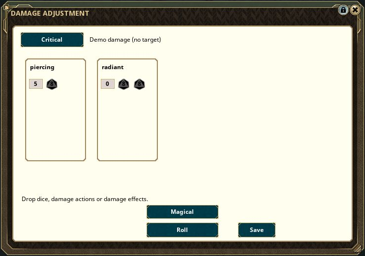
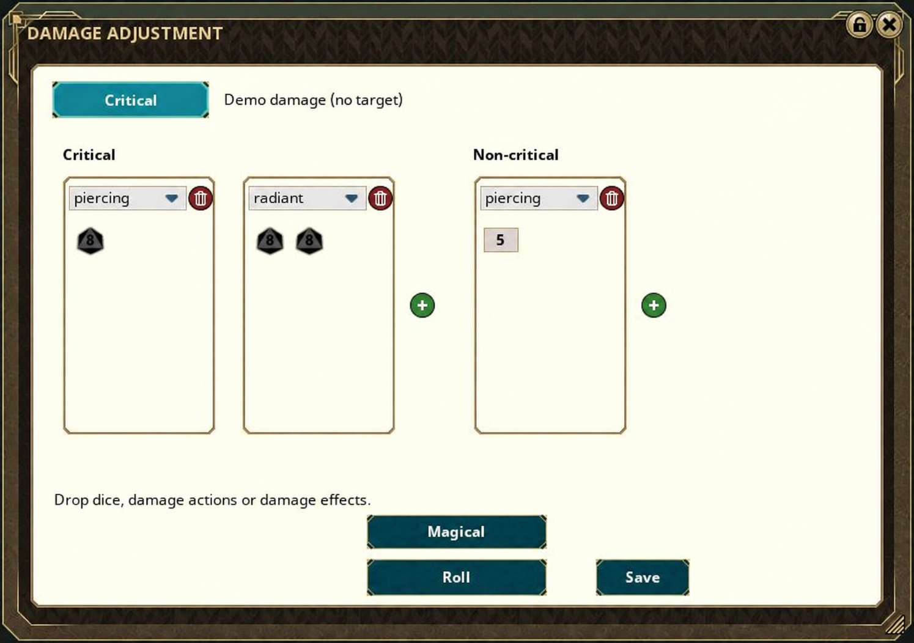
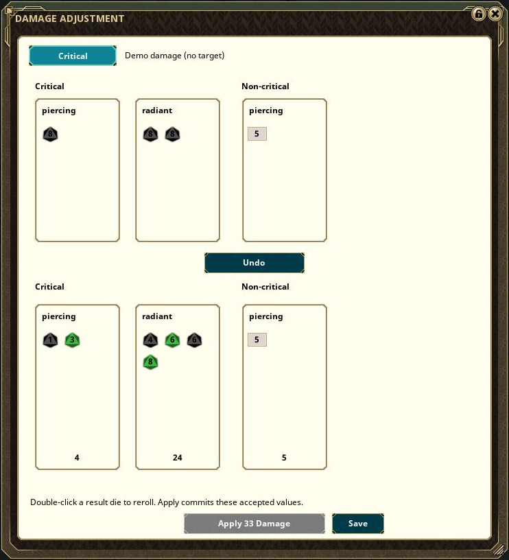
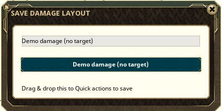

# Damage Workbench

This usage guide covers **v0.3.5**. [Changelog](CHANGELOG.md).

On load, chat shows **Damage Workbench v0.3.5 loaded.**

Review weapon and cantrip damage in Fantasy Grounds Unity 5E, adjust the dice,
roll privately, and apply the result when you are ready.

[Türkçe kullanım](README.tr.md) · [MIT License](LICENSE)

Screenshots show the example panel opened with `/dwb demo`. Appearance follows your active FG theme.

## Open a damage panel

1. Target a creature and make a weapon or cantrip attack, or have the target
   roll a save against a damaging cantrip.
2. A hit or failed save creates a damage request. With **Ask GM**, the GM resolves
   late modifiers and clicks **Confirm HIT**. **Cancel** dismisses the request.
   With **Automatic**, the panel opens without this confirmation.
3. Adjust damage, click **Roll**, review the results, then click **Apply Damage**.

The GM chooses **Ask GM** or **Automatic** under **Options → Damage Workbench →
Confirm hits before damage adjustment**.

You can also use a cantrip's **Damage** action directly: activate it with a target
selected, or drag it onto a creature. A drop does not require selecting that
creature first. The selected damage action is retained; an existing pending
request for the same action and target is reopened. A damage action activated
without a selected or drop target follows the classic FG flow.

For save-based cantrips, a successful save normally produces no DWB request.
Directly using Damage is a separate action; it does not make a new attack or save.

## Choose whether to use DWB

Each user can change **Options → Damage Workbench → Use Damage Workbench
(this user)** during play. The default is **On**. The choice is saved on that
user's computer for the campaign and sent to the GM immediately. It takes effect
for subsequent actions.

**Off** uses the classic FG workflow and dismisses unconfirmed DWB requests.
An already prepared or rolled panel remains available to finish or reopen.
For an online character owner, their preference is used; for unowned characters
or characters whose owner is offline, the GM's preference is used.

## Adjust damage types and dice

Each damage type has its own box (DTZ). The attack name is beside **Critical**.
The lock in the top-right toolbar starts locked. Click it to edit the **damage
type list**; dice can be dropped and edited while the list is locked.

| Action | How to use it |
| --- | --- |
| Add a damage type | Unlock, click **+**, then choose a type from the dropdown. |
| Change a type | Unlock and use its dropdown. A type cannot repeat in the same section. |
| Remove a damage type | Unlock and click its red trash button twice. |
| Add dice | Drag desktop dice into the desired type box. |
| Add a damage action | Drop the action anywhere in the unrolled panel. |
| Select dice | Click dice in one type box. Click again to deselect. |
| Move dice | Drag the selected dice into another type box. |
| Delete dice | Right-click a die and choose **Delete dice**. A selected group is deleted together. |
| Delete with a shortcut | **Ctrl + left-click** a die to delete it or its selected group. |
| Change a fixed bonus | Edit the number directly, or use **Ctrl + mouse wheel** over it. |
| Scroll horizontally | Use the vertical mouse wheel over the boxes or dice, or drag/click the bottom scrollbar. |

An open damage-type dropdown scrolls within its own list. Dice stay sorted from
the smallest die type to the largest; results preserve their order.

**Critical** separates Critical and Non-critical damage. Eligible Critical dice
are doubled; fixed bonuses are not. Put dice in **Non-critical** if they should
not be doubled. Turning Critical off merges the sections; turning it on again
classifies the current dice as eligible for critical damage.

**Magical** starts from the original action and can be toggled before rolling.
Later drops do not change it automatically. Choose a damage type for every box
before rolling.

With the list unlocked, use each section's **+** to add a type and its dropdowns to change types.

## Add Smite, Sneak Attack and other damage effects

Drop an effect action from the character's Actions sheet, or an effect entry,
into a targeted panel before rolling. DWB adds matching **DMG** components,
including damage types. You add these bonuses yourself; DWB does not offer
automatic class-feature suggestions.

| Effect text | Added damage |
| --- | --- |
| `Sneak Attack; DMG: 2d6 weapon;` | 2d6 using the weapon's damage type. |
| `€ Improved Divine Smite; DMG: 1d8 radiant, melee` | 1d8 radiant for a matching melee action. |
| `$ Divine Smite (lvl 1); DMG: 2d8 radiant, melee; IFT: TYPE(undead, fiend); DMG: 1d8 radiant, melee` | 2d8 radiant against a humanoid, or 3d8 against a fiend/undead, for a matching melee action. |
| `Branding Smite (Caster); (C); DMG: {_[UPCAST]+2_}d6 radiant` | With UPCAST=2, 4d6 radiant. Drag the caster's actual effect action so its upcast value can be resolved. |

Conditions such as **IF/IFT**, **ELSE**, target type and melee/ranged filters
are evaluated for the current attacker and target using the installed effect
system. If an upcast expression cannot be resolved, the drop is rejected.
Conditions are checked on drop; remove the added damage and drop the effect
again if the relevant situation changes.

Added dice remain editable and removable. Dropping an effect does not add it to
the combat tracker, spend spell slots, or start concentration. Manage those
through the character's normal spell/effect controls.

## Roll, reroll, Undo and Apply

**Roll** throws the dice privately. Results appear in separate boxes below the
original dice; no damage is applied yet.

Double-click a result die and confirm to **reroll** it. You must use the new
result: you cannot restore that die's previous value. The prompt shows the
character's reroll count for the current combat turn.

**Undo** discards the entire throw and returns to dice setup, including after
a reroll. Use it when you chose the wrong dice and want to prepare damage again.
The turn's reroll count is retained.

**Apply Damage** publishes the accepted results and applies damage to the target.
The panel shows raw damage; resistance, immunity and other target defenses may
reduce damage actually taken. The pending DWB request ends after Apply.

The setup stays above the results. This is a targetless demo: **Apply** is disabled and no target takes damage.

## Close and reopen a panel

Closing with **X** does not apply damage. Every close before Apply adds a reminder
and reopen link to **your chat only**. Click the link, or use `/dwb`, to reopen
pending damage. Unrolled edits are retained when you reopen it.

Pending panels and rolled results last for the current session. Reloading or
restarting clears them; finish pending damage before doing so.

## Save a damage layout

**Save** is available before and after rolling. Enter a name and drag the named
handle into **Quick Actions**. This saves the layout, not rolled results.

Drop the saved layout into an unrolled panel, or activate its Quick Action while
an unrolled panel is open, to replace that panel's entire layout. Activating a
layout without an open panel only displays a usage message.

## Chat commands

| Command | Action |
| --- | --- |
| `/dwb` | Reopen pending damage. |
| `/dwb on` | Enable DWB for this user. |
| `/dwb off` | Use classic FG actions for this user. |
| `/dwb demo` | Open an example panel without a target. You can try Roll and Undo; Apply is disabled. |
