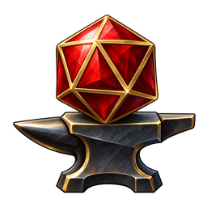
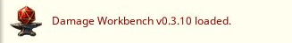
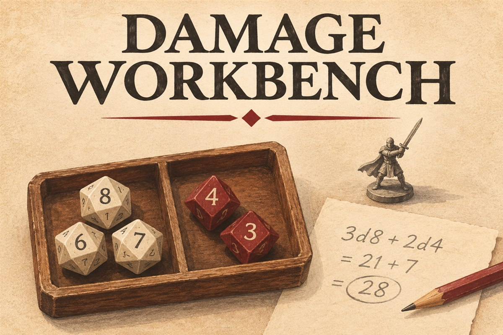
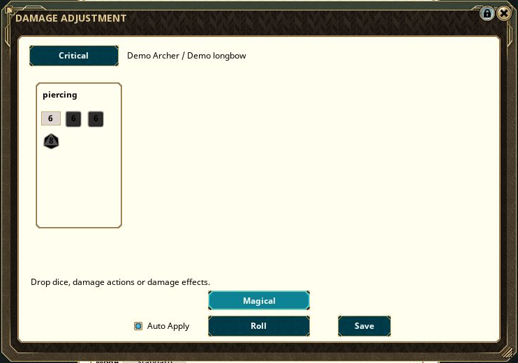
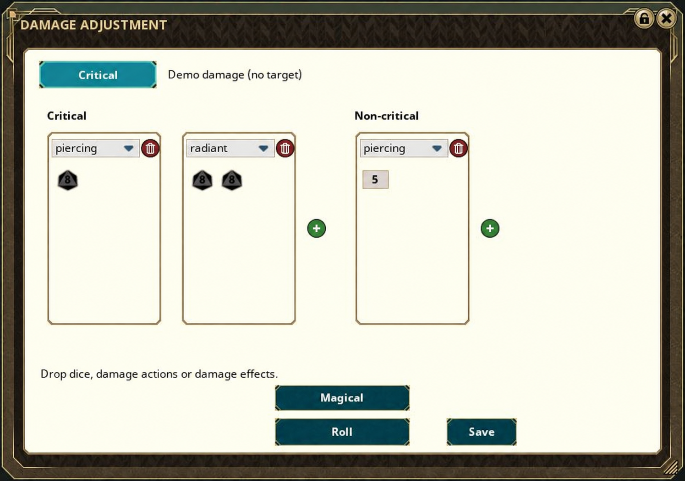
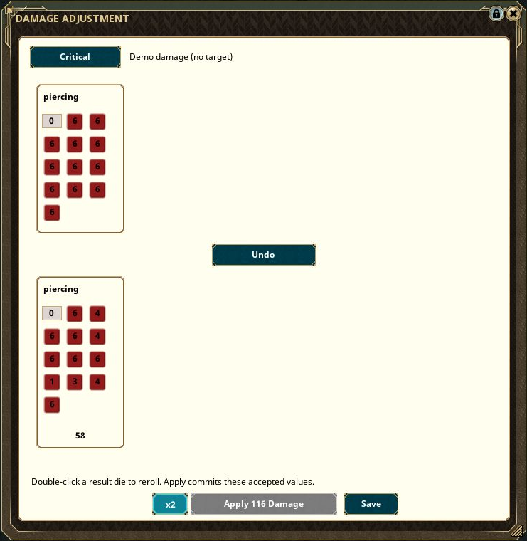
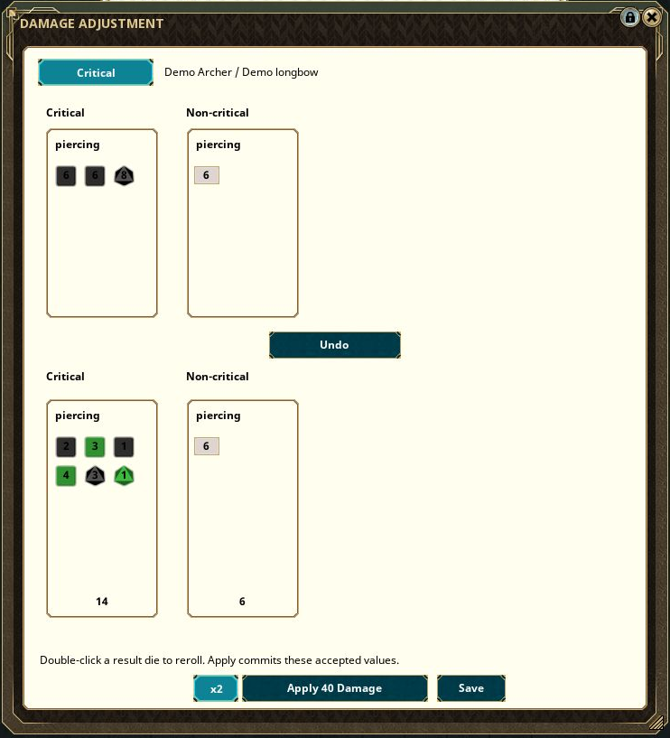
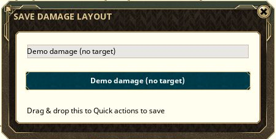

# Damage Workbench

[Forum ve destek](https://www.fantasygrounds.com/forums/showthread.php?88612) · [Forge — Live](https://forge.fantasygrounds.com/shop/items/3793/view)

**2026-11-20** itibarıyla ücretsiz Forge ürünü onaylandı ve **ACTIVE/listed** durumda; v0.3.11 **build #1 Live kanalında**. Yayın koordinatörü bu durumları doğruladı; forum konusu da yayında. Bağımsız bir Forge Updater indirmesi henüz uçtan uca test edilmedi.

Bu kullanım rehberi **v0.3.11** içindir. [Değişiklik günlüğü](CHANGELOG.md).

Yüklenince sohbette **Damage Workbench v0.3.11 loaded.** mesajı görünür.

Fantasy Grounds Unity 5E'de silah ve cantrip hasarını incele, zarları düzenle,
zarları at ve hazır olduğunda sonucu uygula.

[English guide](README.md) · [MIT Lisansı](LICENSE)

Test edilen temel ortam: **FG Unity 5.1.15**, **CoreRPG/5E 2026-10-06**. Daha eski
sürümler desteklenen temel ortam değildir. DWB native 5E aksiyon kayıtlarını kullanır;
2014/2024 sınıf özelliklerinin ayrı ve kapsamlı doğrulaması iddia edilmez. İstek akışı
**PC silahları ve cantripler** içindir; genel seviyeli büyü veya NPC saldırısı yakalama
kapsam dışıdır. Envanter ok yığınlarını azaltan ek extension entegrasyonları doğrulanmamıştır.
[Güncel kontroller ve sınırlar](TESTING.md#current-acceptance-summary).

[Forge açıklaması ve dağıtım bilgileri (İngilizce)](docs/forge/description.md).

Güncel hedefli görüntüler sandbox içindeki sentetik Demo Archer kaydını kullanır. Eski demo örnekleri aşağıda ayrıca belirtilir. Görünüm aktif FG temasına göre değişir.

## “Dur, ek hasarımı unuttum” demeden önce

Aynı silah isabetinin hasarı her tur değişebilir. Sneak Attack, Hex, Hunter's Mark veya Divine Smite ekini hasarı uygulamadan önce panelde tamamla. Unutulan bonusları ayrı hasar işlemleri olarak uygulamak concentration kontrollerini veya System Shock gibi toplam hasar eşiğine bağlı kararları değiştirebilir. DWB hazırlanan isabeti tek hasar uygulaması olarak FG'ye gönderir; bu devam kontrollerini DWB otomatik yönetmez. Kurallar, ruleset, diğer extension'lar ve GM belirler.

- **Tüm ekleri birlikte hazırla:** zar ekle, hasar aksiyonu veya uygun **DMG** effect'i bırak. Örneğin **1d8 piercing + 3d6 piercing Sneak Attack + 1d6 necrotic Hex** aynı isabetin içinde, doğru tür kutularında bulunabilir. Hunter's Mark ve Divine Smite için de uygulanabilir bileşeni ekle; zaten eklenmiş bonusu tekrarlama.
- **Düşük gelen zarı incele:** atıştan önce **Auto Apply** işaretini kaldır. Uygun sonuç zarına çift tıklayıp reroll'u onayla; yeni sonuç geçerlidir. Pencerede karakterin mevcut combat turn içindeki reroll sayısı görünür. Piercer gibi feat'lerin uygunluğunu ve tur başına sınırını sen kontrol edersin; sayaç bunları otomatik dayatmaz. Otomatik zar eşikleri ayrı bir araçtır.
- **Kritik ek zarını ikinci kez katlama:** ikiye katlanacak zarları **Critical**, yalnız bir kez eklenecekleri **Non-critical** bölümüne koy. Piercer kritik isabetinin ek silah zarı Non-critical'da bir kez eklenir. Bölümün adı zarın kritik isabetten kaynaklanmadığı anlamına gelmez; yalnız katlanmasını yönetir. Sabit bonuslar katlanmaz.
- **Hasar türünü koru:** piercing, necrotic ve radiant bileşenleri doğru kutularda tut. Tür listesinin kilidini açıp kutu ekleyebilir veya tür değiştirebilir, zarları kutular arasında taşıyabilirsin. FG'nin native savunma çözümü resistance, immunity ve desteklenen **ABSORB** effect'lerini işler; DWB ayrı bir absorb sistemi kurmaz. Hedefin aldığı hasar ham toplamdan farklı olabilir.
- **Sık kullandığın isabeti kaydet:** **Save → ad ver → adlandırılmış handle'ı Quick Actions'a sürükle**. Sonraki isabette henüz atılmamış panel açıkken Quick Action'ı çalıştır veya kaydı panele bırak. Bu, bütün layout'u değiştirir; hedefi, koşulları ve Critical durumunu gözden geçir. Önceki sonuçlar değil, kurulum ve otomatik reroll eşikleri saklanır.

Her oyuncu yalnız kendi akışı için `/dwb off` ile klasik FG'ye dönebilir; diğerleri DWB kullanmayı sürdürebilir. Oyun sırasında `/dwb on` ile yeniden açılır.

## Ayarlar: Options → Damage Workbench

| Ayar | Tüm değerler ve pratik etkisi | Kapsam ve kalıcılık |
| --- | --- | --- |
| **Use Damage Workbench (this user)** | **On (varsayılan):** desteklenen sonraki aksiyonlarda DWB kullanılır. **Off:** klasik FG akışı kullanılır, onaylanmamış istekler kaldırılır; hazırlanmış veya atılmış paneller tamamlanabilir. | Her GM/oyuncunun kişisel tercihidir. O bilgisayarda bu kampanya için saklanır; değişiklik anında GM'ye iletilir. Çevrimiçi karakter sahibinin, aksi halde GM'nin tercihi kullanılır. `/dwb on` ve `/dwb off` aynı ayarı değiştirir. |
| **Confirm hits before damage adjustment** | **Ask GM (varsayılan):** panel açılmadan GM isabeti onaylar; son değiştiriciler çözülebilir. **Automatic:** ayrı GM onayı beklemeden panel açılır; hasarı otomatik uygulamaz. | GM'nin yönettiği kampanya ayarıdır. Kampanyada saklanır ve reload sonrasında korunur. |

DWB'nin kaydettiği Options girdileri yalnız bu ikisidir. **Auto Apply**, paneldeki ayrı kişisel kutudur: **işaretli (varsayılan)** zarlar durduğunda hasarı uygular; **işaretsiz** sonuçları inceleme, manuel reroll, Undo veya x2 için Apply'a kadar bekletir. Hedefli panelde **Roll** basıldığında tercih, kayıtlı değerden farklıysa o bilgisayarda bu kampanya için kaydedilir. Yalnız kutuyu değiştirmek kaydetmez. Sonraki panel kayıtlı tercihi getirir; demo sonuçları denemek için açık bırakır.

## Hasar panelini aç

1. Bir hedef seçip silah veya cantrip saldırısı yap ya da hasar veren cantrip'e
   karşı hedefe kurtarma atışı yaptır.
2. İsabet veya başarısız kurtarma bir hasar isteği oluşturur. **Ask GM** modunda
   GM son değiştiricileri çözüp **Confirm HIT** düğmesine basar. **Cancel** isteği
   kapatır. **Automatic** modunda panel bu onay beklenmeden açılır.
3. Hasarı düzenle ve **Roll** ile at. **Auto Apply** işaretliyse zarlar durduğunda
   hasar uygulanır. Sonucu önce incelemek için atıştan önce işareti kaldır.

Takip açık olan menzilli silahlarda Fantasy Grounds'un silah mühimmatı sayacı
kullanılır. Normal saldırıda mühimmat, ıskalasana da, Attack sırasında harcanır.
Sayım Workbench'e kaldıysa mühimmat hasar uygulanırken harcanır. Roll ve Undo
sayacı değiştirmez. GM onay panelindeki not, o saldırıda Cancel'ın etkisini
gösterir. Cancel hasar isteğini kapatır ve sayacı olduğu gibi bırakır.

GM, **Options → Damage Workbench → Confirm hits before damage adjustment**
ayarından **Ask GM** veya **Automatic** seçer.

- **Ask GM (varsayılan):** sahibin hasar paneli açılmadan önce GM isabeti onaylar; sonradan eklenen değiştiriciler bu aşamada çözülebilir.
- **Automatic:** ayrı GM onayı beklemeden hasar panelini açar. Hasarı otomatik uygulamaz; bunu paneldeki ayrı **Auto Apply** kutusu yönetir.

Bu kampanya ayarını GM yönetir; kampanyada saklanır ve reload sonrasında korunur. Diğer Settings girdisi **Use Damage Workbench (this user)**, aşağıda anlatılan kişisel tercihtir. DWB başka Settings girdisi eklemez.

Cantrip'in **Damage** aksiyonunu doğrudan da kullanabilirsin: hedef seçiliyken
çalıştır veya bir yaratığın üzerine sürükleyip bırak. Üzerine bıraktığın hedefin
önceden seçili olması gerekmez. Seçtiğin hasar aksiyonu korunur; aynı aksiyon ve
hedef için bekleyen bir istek varsa yeniden açılır. Seçili hedef veya bırakılan
hedef olmadan çalıştırılan hasar aksiyonu klasik FG akışında devam eder.

Kurtarma isteyen cantrip'lerde başarılı kurtarma normalde DWB isteği oluşturmaz.
Damage'ı doğrudan kullanmak ayrı bir işlemdir; yeni saldırı veya kurtarma atışı yapmaz.

## DWB kullanıp kullanmayacağını seç

Her kullanıcı **Options → Damage Workbench → Use Damage Workbench (this user)**
ayarını oyun sırasında da değiştirebilir. Varsayılan **On**'dur. Tercih o
kullanıcının bilgisayarında, kampanya için kaydedilir ve anında GM'ye iletilir.
Sonraki işlemlerde yeni tercih kullanılır.

**Off**, klasik FG akışını kullanır ve henüz onaylanmamış DWB isteklerini kaldırır.
Hazırlanmış veya atılmış bir hasar paneli tamamlanabilir ya da yeniden açılabilir.
Karakterin sahibi çevrimiçiyse onun tercihi; karakter sahipsizse veya sahibi
çevrimdışıysa GM'nin tercihi kullanılır.

## Hasar türlerini ve zarları düzenle

Her hasar türünün ayrı bir kutusu (DTZ) vardır. Saldırı adı **Critical** düğmesinin
yanındadır. Sağ üstteki kilit başlangıçta kilitlidir. Kilide tıklamak **hasar
türleri listesini** düzenlemeye açar; liste kilitliyken de zar ekleyip düzenleyebilirsin.

| İşlem | Nasıl yapılır? |
| --- | --- |
| Hasar türü ekle | Kilidi aç, **+** düğmesine bas ve açılır listeden tür seç. |
| Türü değiştir | Kilidi aç ve tür listesini kullan. Aynı bölümde bir tür tekrarlanamaz. |
| Hasar türünü kaldır | Kilidi aç ve kutunun kırmızı çöp kutusu düğmesine iki kez bas. |
| Zar ekle | Masaüstündeki zarları istediğin tür kutusuna sürükle. |
| Hasar aksiyonu ekle | Aksiyonu henüz atılmamış panelin herhangi bir yerine bırak. |
| Zar seç | Bir tür kutusundaki zarlara tıkla. Tekrar tıklamak seçimi kaldırır. |
| Zar taşı | Seçili zarları başka bir tür kutusuna sürükle. |
| Zar sil | Zara sağ tıklayıp **Delete dice** seç. Seçili grup birlikte silinir. |
| Kısayolla sil | **Ctrl + sol tık** ile zarı veya ait olduğu seçili grubu sil. |
| Sabit bonusu değiştir | Sayıyı yaz veya üzerinde **Ctrl + mouse wheel** kullan. |
| Yatay kaydır | Tür kutuları veya zarların üzerindeyken dikey mouse wheel kullan; alt çubuğu sürükleyebilir veya çubuğa tıklayabilirsin. |

Açık hasar türü listesi kendi içinde kayar. Zarlar küçük türden büyüğe sıralanır;
sonuçlar da aynı sırayı korur.

**Critical**, Critical ve Non-critical hasarı ayırır. Critical bölümündeki uygun
zarlar ikiye katlanır; sabit bonuslar katlanmaz. Katlanmaması gereken zarları
**Non-critical** bölümüne koy. Critical'ı kapatmak bölümleri birleştirir;
yeniden açmak mevcut zarları kritik hasara uygun olarak sınıflandırır.

**Magical** ilk aksiyondan gelir ve atıştan önce değiştirilebilir. Sonradan
yaptığın drop'lar bu düğmeyi otomatik değiştirmez. Atmadan önce her kutu için
bir hasar türü seç.

Kilit açıkken her bölümün **+** düğmesiyle tür ekleyebilir, açılır listelerden tür değiştirebilirsin.

## Otomatik reroll

Atıştan önce bir zara sağ tıkla ve **Reroll if lower or equal than** menüsünden eşik seç. Varsayılan **No auto reroll** işaretlidir. 1'den zarın en büyük değerinin bir altına kadar seçim yapılabilir; d20'den büyük zarlarda menü yoktur. FG'nin menü sınırı nedeniyle büyük zarların seçenekleri sayı aralıkları altında gruplanır. Seçili eşik menü tekrar açıldığında işaretli görünür.

Eşiğe eşit veya daha düşük sonuç, native FG motoruyla **bir kez** yeniden atılır; ikinci sonuç kullanılır. Örneğin `r2#1`, 1 ve 2 sonuçlarını bir kez yeniler. Drop edilen native reroll bilgisi otomatik alınır; tekrarlı `rN` modu varsa o davranış korunur. Reroll işaretli zar düzenleme görünümünde renkle ayırt edilir; drop edilen renk/skin ve native sonuç renkleri korunur. **Save** eşik ayarını da saklar.

Sonuç zarının üzerine gelerek otomatik reroll sırasında elenen denemeleri görebilirsin. Hasara yalnızca kabul edilen sonuç eklenir.

Bu örnekte 12d6 sonucu 58; x2 açıkken Apply üzerinde 116 görünür. Demo hasar uygulamaz.

## Smite, Sneak Attack ve diğer hasar effect'lerini ekle

Karakterin Actions sayfasındaki effect aksiyonunu veya bir effect kaydını,
atıştan önce hedefli hasar paneline bırak. DWB, eşleşen **DMG** bileşenlerini
hasar türleriyle birlikte ekler. Bu bonusları kendin eklersin; DWB otomatik
sınıf özelliği önerileri sunmaz.

| Effect metni | Eklenen hasar |
| --- | --- |
| `Sneak Attack; DMG: 2d6 weapon;` | Silahın hasar türüyle 2d6. |
| `€ Improved Divine Smite; DMG: 1d8 radiant, melee` | Eşleşen yakın dövüş aksiyonunda 1d8 radiant. |
| `$ Divine Smite (lvl 1); DMG: 2d8 radiant, melee; IFT: TYPE(undead, fiend); DMG: 1d8 radiant, melee` | Eşleşen yakın dövüş aksiyonunda humanoid'e 2d8, fiend/undead'e 3d8 radiant. |
| `Branding Smite (Caster); (C); DMG: {_[UPCAST]+2_}d6 radiant` | UPCAST=2 için 4d6 radiant. Upcast değerinin çözülebilmesi için caster'ın gerçek effect aksiyonunu sürükle. |

**IF/IFT**, **ELSE**, hedef türü ve melee/ranged gibi koşullar, kurulu effect
sistemiyle mevcut saldırgan ve hedef için değerlendirilir. Upcast ifadesi
çözülemiyorsa drop reddedilir. Koşullar drop anında kontrol edilir; ilgili durum
değişirse eklenen hasarı kaldırıp effect'i yeniden bırak.

Eklenen zarlar düzenlenebilir ve silinebilir. Effect bırakmak onu combat tracker'a
eklemez, spell slot harcamaz veya concentration başlatmaz. Bunları karakterin
normal spell/effect kontrollerinden yönet.

## Roll, reroll, Undo ve Apply

**Auto Apply**, **Roll** düğmesinin yanında işaretli başlar. Zarları incelemek,
yeniden atmak, atışı geri almak veya **x2** kullanmak istiyorsan işareti kaldır.
**Roll** düğmesine basınca tercih bu kampanya için kendi bilgisayarında kaydedilir
ve sonraki hasar panelinde hatırlanır. Demo paneli, deneme yapabilmen için sonuçları açık bırakır.

**Roll**, zarları atar. Oyuncuların normal atışları ve reroll'ları **Chat: Show GM rolls** kapalı olsa da diğer oyunculara görünür. DM atışları bu ayara uyar. **Chat: Show results to players** (On, Off, Friendly veya Friendly only) hedefe ilişkin sonuç mesajlarını ayrıca yönetir. Elle uygulama modunda sonuçlar, ilk zar kutularının altında **Apply Damage** düğmesine basana kadar görünür.

Elle uygulama modunda her kabul edilen Roll veya Reroll sonrasında zarlar ve toplamları sohbette **PENDING APPLY** etiketiyle görünür. Hasar otomatik veya elle uygulandığında Fantasy Grounds'un hasar atışı kartı sohbette görünür. Atışı gören herkes toplamı da görür. Gizli ve tower atışlarında toplamı DM ile zarı atan oyuncu görür. Hedefin savunmaları alınan gerçek hasarı değiştirebilir.

Bir sonuç zarına çift tıklayıp onaylayarak **reroll** yap. Yeni sonucu kullanman
gerekir; o zarın eski sonucuna dönemezsin. Onay penceresi, karakterin mevcut
combat turundaki reroll sayısını gösterir.

**Undo**, reroll sonrasında da tüm atışı bırakıp zar düzenlemeye döner. Yanlış
zarları seçtiysen hasarı yeniden hazırlamak için kullan. Turun reroll sayacı korunur. Her Undo, kaldırılan zarları, sonuçlarını, hasar türlerini ve toplamı **yalnızca DM ve Undo yapan oyuncunun** sohbetine yazar.

**x2**, Apply düğmesinin solundadır ve başlangıçta kapalıdır. Açıldığında Apply üzerindeki toplam iki katına çıkar; zar sonuçları değişmez. Çarpan native hasar uygulamasına gider; hedefin resistance/immunity işlemleri normal çalışır. Bu seçim tek hasar isteği içindir, Save ile saklanmaz.

**Apply Damage**, kabul ettiğin sonuçları sohbete gönderir ve hedefe hasarı uygular.
Panel ham hasarı gösterir; resistance, immunity ve diğer hedef savunmaları alınan
gerçek hasarı azaltabilir. Apply sonrasında bekleyen DWB isteği sona erer.

Üstte hazırlanan zarlar, altta sonuçlar görünür. Bu sentetik hedefli örnekte ham toplam 20'dir; **x2**, zarları değiştirmeden Apply değerini 40 yapar.

## Paneli kapat ve yeniden aç

**X** ile kapatmak hasar uygulamaz. Apply öncesindeki her kapatışta **yalnızca
senin sohbetine** bir hatırlatma ve yeniden açma bağlantısı gelir. Bağlantıya
tıkla veya `/dwb` kullanarak bekleyen hasarı aç. Atış öncesi düzenlemelerin korunur.

Bekleyen paneller ve atış sonuçları mevcut oturum boyunca tutulur. Reload veya
yeniden başlatma bunları temizler; önce bekleyen hasarı tamamla.

## Hasar yerleşimini kaydet

**Save**, atıştan önce ve sonra kullanılabilir. Bir ad girip adlandırılmış
tutamacı **Quick Actions** alanına sürükle. Atış sonuçları değil, yerleşim kaydedilir.

Kaydı henüz atılmamış bir panele bırak veya böyle bir panel açıkken Quick Action'ı
çalıştır. Mevcut yerleşimin tamamı değiştirilir. Panel kapalıyken kaydı çalıştırmak
yalnızca kullanım mesajı gösterir.

## Sohbet komutları

| Komut | İşlev |
| --- | --- |
| `/dwb` | Bekleyen hasarı yeniden aç. |
| `/dwb on` | Bu kullanıcı için DWB'yi aç. |
| `/dwb off` | Bu kullanıcı için klasik FG akışına geç. |
| `/dwb demo` | Hedefsiz örnek panel aç. Roll ve Undo denenebilir; Apply devre dışıdır. |

Güncel hedefli görüntüler ve yüklenme duyurusu v0.3.10 ile alındı; yukarıdaki eski demo örnekleri korunmuştur. v0.3.11 yalnız paketleme ve sürüm metadatasını değiştirir.
