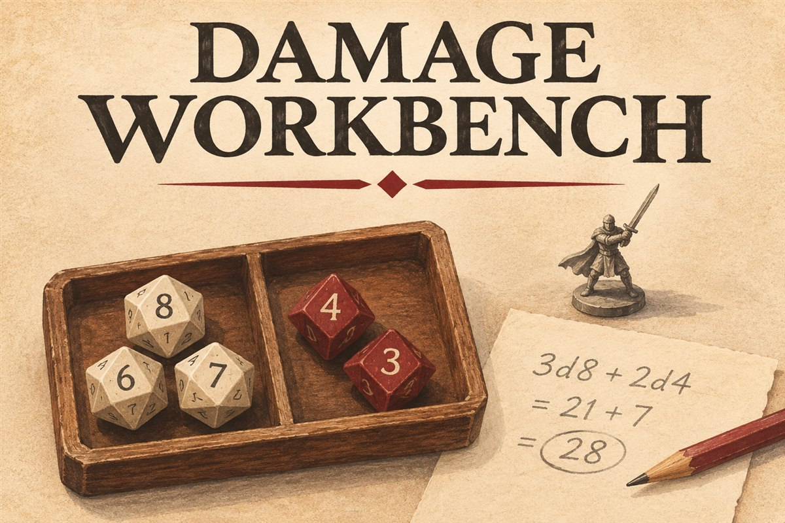
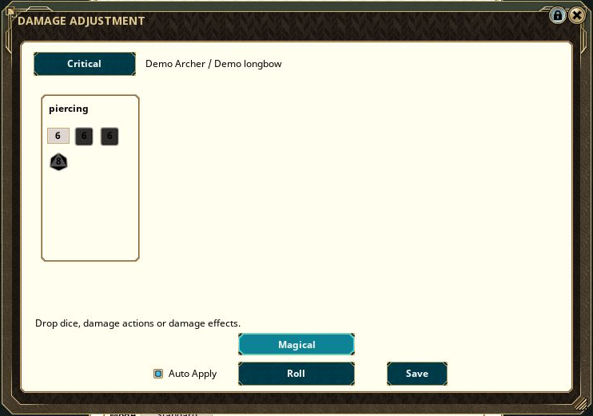
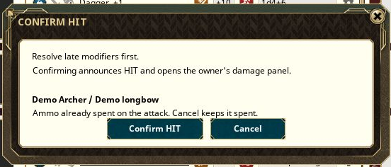
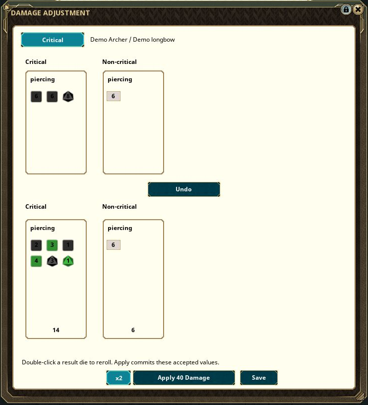

# Damage Workbench

Damage Workbench adds an editable damage panel to PC weapon hits and damaging cantrips in Fantasy Grounds Unity's **5E ruleset**. Prepare the damage you intend to deal, then roll with **Auto Apply**, or turn it off to inspect and reroll results before applying them.

## Get the whole hit right before applying it

"Wait, I forgot Sneak Attack." The same weapon hit can deal different damage every turn. Add the missing dice before applying the hit, rather than applying each forgotten bonus separately. Separate damage events can change concentration checks or a threshold-based ruling such as System Shock. DWB prepares one damage application; follow-up checks still depend on your ruleset, extensions and DM.

- **Sneak Attack, Hex, Hunter's Mark or Divine Smite:** increase the dice directly, drop a damage action, or drop a supported **DMG** effect into the unrolled panel. Matching components include their damage types. Add only eligible bonuses that are not already included. For example, prepare **1d8 piercing + 3d6 piercing Sneak Attack + 1d6 necrotic Hex** together, keeping piercing and necrotic in separate groups.
- **A low damage die:** turn **Auto Apply off** before rolling. Double-click an eligible result die and confirm the reroll; the new result stands. The prompt shows the character's reroll count for the combat turn. You enforce a feature's limits, such as Piercer's once-per-turn use; DWB does not enforce feat eligibility. Automatic per-die reroll thresholds are a separate option.
- **An extra die on a critical:** put dice that should double in **Critical** and dice added once in **Non-critical**. A Piercer critical's extra weapon die belongs in the latter so it is not doubled again. The section controls multiplication, not whether that extra die was granted by a critical hit. Fixed bonuses do not double.
- **Mixed damage types:** keep piercing, necrotic, radiant and other components in their correct groups. Unlock the type list to add or change groups and drag dice between them. Native FG defenses resolve resistance, immunity and supported native **ABSORB** effects; the applied damage can differ from the raw panel total.
- **Your regular big hit:** prepare a layout, click **Save**, enter a name such as **Rapier + Sneak Attack + Hex**, and drag the named handle into **Quick Actions**. On a later hit, activate it with an unrolled panel open, or drop it into that panel. It replaces the entire layout, so review the target, conditions and critical state. Save retains the setup and automatic reroll thresholds, not previous results.

### Optional for each player

An individual player can keep the classic FG workflow while everyone else uses DWB. Set **Options → Damage Workbench → Use Damage Workbench (this user)** to Off, or enter `/dwb off`. Use `/dwb on` to enable it again during play. This preference affects only that user.

## What you can do

- Group dice and fixed bonuses by damage type, and drag dice between groups.
- Separate damage that doubles on a critical from damage that does not.
- Drop damage actions and DMG effects, including Sneak Attack and Smite effects. Conditions are evaluated for the current attacker and target when dropped.
- Configure per-die automatic reroll thresholds, review retained results, and optionally apply x2 damage.
- Save reusable damage layouts to Quick Actions.
- Undo a throw and revise the setup. The GM and roller receive a private record of the discarded results.
- Choose classic FG actions or DWB independently for each user, including during play.

**Auto Apply starts on.** Uncheck it before Roll if you want to review results, reroll, Undo, or choose x2. The choice is remembered locally for the campaign when you roll. The GM can require Confirm HIT before the owner's panel opens.

## First use

Enable **Damage Workbench** in the campaign's extension list. Target a creature and make a PC weapon or cantrip attack, or resolve a damaging cantrip's save. After a hit or failed save, confirm the request if required, adjust damage, and click Roll. Direct cantrip Damage actions also work with a selected target or when dropped on a creature.

Try `/dwb demo` without a target to explore the panel safely. Demo damage cannot be applied. `/dwb` reopens pending damage. Each user can toggle **Options → Damage Workbench → Use Damage Workbench (this user)**, or use `/dwb on` and `/dwb off`.

Full usage guides: [English](https://github.com/alperozisik/FG-Damage-Workbench/blob/main/README.md) · [Türkçe](https://github.com/alperozisik/FG-Damage-Workbench/blob/main/README.tr.md).

## Settings: Options → Damage Workbench

| Setting | All values and practical effect | Scope and persistence |
| --- | --- | --- |
| **Use Damage Workbench (this user)** | **On (default):** use DWB for supported subsequent actions. **Off:** use classic FG actions and dismiss unconfirmed requests; prepared or rolled panels remain available. | Each GM/player controls their own preference. Saved on that computer for this campaign; changes are sent to the GM immediately. An online character owner's preference applies; otherwise the GM's applies. `/dwb on` and `/dwb off` change this same setting during play. |
| **Confirm hits before damage adjustment** | **Ask GM (default):** GM confirms before the owner's damage panel opens, allowing late modifiers to be resolved. **Automatic:** open without separate GM confirmation; this does not automatically apply damage. | GM-controlled campaign option, saved with the campaign and retained across reloads. |

These are the only two Options entries registered by DWB. **Auto Apply** is a separate personal panel checkbox: **checked (default)** applies damage when the roll lands; **unchecked** leaves results pending for review, manual rerolls, Undo or x2 before Apply. On a targeted panel, clicking **Roll** saves the choice locally for this campaign only if it differs from the saved value. Merely toggling the box does not save it. The next panel restores that saved choice; the demo leaves results open for practice.

## Screenshots

Native v0.3.10 candidate UI with synthetic sandbox data; v0.3.11 changes packaging/version metadata only. The first listing cover is an illustration, not a screenshot.

## Requirements and scope

- Release documented here: **v0.3.11**. Tested on Windows with **FG Unity 5.1.15**; earlier verification records identify CoreRPG/5E rulesets dated **2026-10-06**. Earlier FG/ruleset versions are not a supported baseline.
- Uses native 5E action records rather than implementing a separate 2014 or 2024 rules engine. Separate, exhaustive 2014/2024 class-feature certification is not claimed.
- The request workflow supports **PC weapon damage and cantrips**. General levelled-spell and NPC attack interception is outside its current scope. A targetless direct cantrip Damage action follows classic FG behavior.
- Added effects do not spend spell slots or start concentration. Handle those on the normal character sheet. Unresolved dynamic expressions are rejected rather than guessed. Re-drop conditional damage if the relevant situation changes.
- Pending requests last for the current session; finish them before reloading or restarting.
- Ordinary player dice and totals are public. Hidden GM and explicit secret/tower throws retain privacy. Native target-defense messages follow FG's result settings.
- Native ranged-weapon **used-ammo counters** are supported. Normal attacks can spend a shot before damage, including on a miss. DWB does not count it again. Deferred counting happens only on Apply; Roll and Undo do not spend ammo. Cancel leaves the counter unchanged and its notice explains whether the shot was already spent. Inventory-stack ammunition extensions are not certified.
- Other extensions and themes can change native behavior. See the [verification record](https://github.com/alperozisik/FG-Damage-Workbench/blob/main/TESTING.md) for tested combinations and remaining limits.

## Download, updates and removal

The [public GitHub release](https://github.com/alperozisik/FG-Damage-Workbench/releases/latest) contains `DamageWorkbench.ext`, the source archive and SHA256 checksums. For manual installation, place the `.ext` in FG's data-directory `extensions` folder and enable it before loading the campaign. Close FG before replacing the file to update. Keep one copy; do not load a manual copy alongside a Forge-managed duplicate.

Once this item is published on Forge, subscribe there and run FG's Updater while FG sessions are closed. Disable the extension in the campaign launcher to stop using it; existing character and inventory records remain native FG records. Finish pending DWB damage before disabling or updating.

MIT licensed. [Source and releases](https://github.com/alperozisik/FG-Damage-Workbench) · [Changelog](https://github.com/alperozisik/FG-Damage-Workbench/blob/main/CHANGELOG.md) · [Report an issue](https://github.com/alperozisik/FG-Damage-Workbench/issues).
